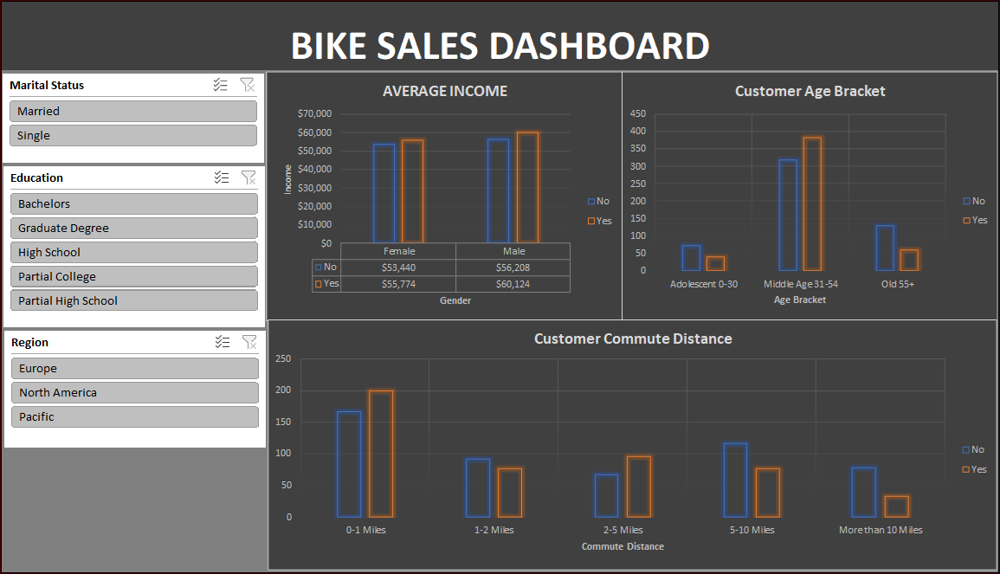

# Bike Sales Exploratory Analysis & Interactive Dashboard (v1)

An interactive sales and customer demographic dashboard built in **Microsoft Excel** to identify purchasing patterns across customer income, age groups, and commute distances.

> **Project Context & Status:** Created as a hands-on **Data Analytics Practice Project** focusing on end-to-end spreadsheet cleaning, Pivot Table modeling, and interactive dashboard design.  
> **Current Release:** **Version 1 (Initial Dashboard Release)** — Core data cleaning, Pivot Tables, and initial visual exploration are complete. Additional customer segmentation, KPI cards, and deeper trend metrics will be added in future iterations.

---

### 📊 Dashboard Preview (v1)

---

### 🎯 Objective
Analyze customer demographic and commuting data to uncover which customer segments are most likely to purchase a bike—helping inform targeted marketing and inventory planning.

---

### 🧹 Data Cleaning & Preparation
Before building the analysis, the raw dataset underwent structured cleaning in Excel:
* **Duplicate Removal:** Identified and removed duplicate customer records (`ID`) to prevent skewed counts.
* **Data Standardization:** Replaced abbreviated codes with readable labels (`M` / `S` → *Married* / *Single*; `M` / `F` → *Male* / *Female*) using Find & Replace.
* **Formatting:** Standardized the `Income` column to currency format without unnecessary decimal clutter.
* **Feature Engineering (`Age Brackets`):** Created a derived `Age Bracket` column using nested `IF` logic to group customers into three actionable segments:
  * **Adolescent** (`< 31`)
  * **Middle Age** (`31 – 54`)
  * **Old** (`> 54`)

---

### 📈 Pivot Tables & Visual Components (v1)
1. **Average Income by Gender & Purchase Status:** Compares average customer income between buyers and non-buyers across male and female segments.
2. **Customer Age Brackets vs. Bike Purchases:** Tracks purchase volume across *Adolescent*, *Middle Age*, and *Old* brackets—highlighting **Middle Age (31–54)** customers as the primary buying segment.
3. **Commute Distance vs. Bike Purchases:** Examines how daily commute length (*0–1 Miles*, *1–2 Miles*, *2–5 Miles*, *5–10 Miles*, *10+ Miles*) impacts bike purchase likelihood.
4. **Interactive Slicers:** Added dynamic filters for **Marital Status**, **Region**, and **Education** so users can slice all three charts simultaneously.

---

### 🛠️ Tools & Excel Features Used
* **Data Cleaning:** Remove Duplicates, Find & Replace, Data Formatting
* **Formulas:** Nested `IF` statements for age segmentation
* **Analysis & Visualization:** Pivot Tables, Pivot Charts (Bar & Line Charts), Interactive Slicers

---

### 🚀 Planned Enhancements (v2 Roadmap)
* Add summary **KPI Cards** (Total Customers, Overall Conversion Rate %, Average Buyer Income).
* Expand regional and education-level conversion rate comparisons using `COUNTIFS` and `AVERAGEIFS`.
* Refine visual layout and conditional formatting highlights.
